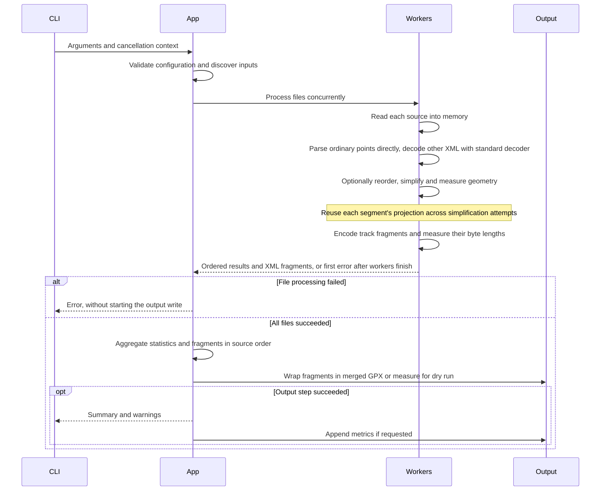

# Architecture

Start with [app.Run](../internal/app/app.go) and follow its imports for the current implementation. Package tests describe edge cases. This document keeps the processing overview and the reasons behind decisions that are easy to lose in code.

## Processing sequence

## Decision records

- [ADR 0001: Collect results by source index](adr/0001-collect-results-by-source-index.md) explains why the pool does not collect and sort results through a channel.
- [ADR 0002: Abort the merge on a file error](adr/0002-abort-on-file-errors.md) records the move away from partial-success output.
- [ADR 0003: Parse XML directly into tracks](adr/0003-parse-xml-directly-into-tracks.md) records the allocation trade-off and the parser's validation responsibility.
- [ADR 0004: Read common GPX points faster and generate track XML once](adr/0004-accelerate-point-parsing-and-reuse-encoded-tracks.md) explains why the faster merge keeps source data and generated XML in memory.
